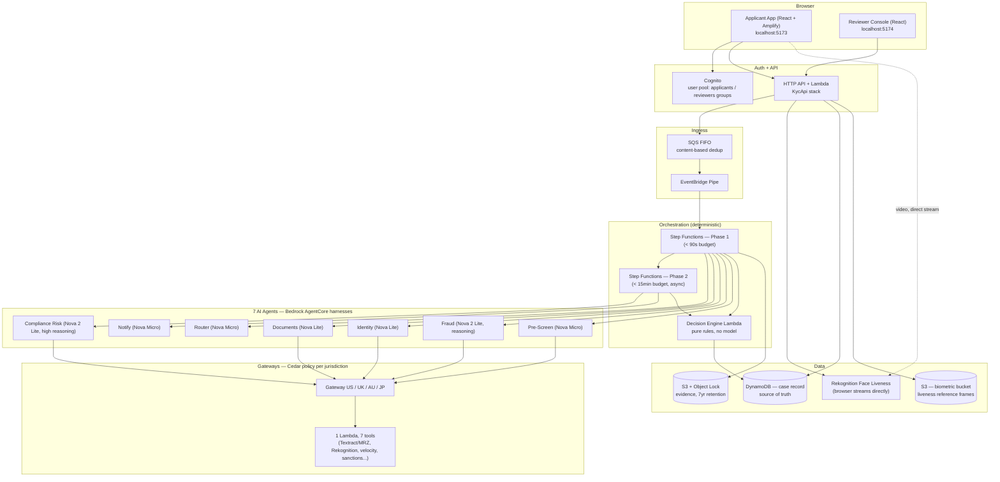

# KYC in 90 Seconds

Agentic KYC (Know Your Customer) onboarding pipeline built for AWS re:Invent 2026. An
applicant proves who they are through a browser (liveness selfie + ID document), seven AI
agents (Amazon Bedrock AgentCore, Nova models) verify the evidence, a deterministic rules
engine decides the outcome, and a human reviewer handles anything the rules can't clear on
their own.

This document is the single place to go from "empty machine" to "full working demo,
end to end, no gaps." Read it top to bottom once before touching anything.

---

## 1. What this actually is (plain English)

- An **applicant** fills in their details, uploads an ID document (passport), does a
  liveness selfie check in the browser, and submits.
- The submission drops onto a queue. A **Step Functions** state machine picks it up and
  runs **4 AI agents in parallel**: Documents, Identity, Fraud, Pre-Screen (sanctions).
  Each agent calls real AWS tools (Textract, Rekognition, DynamoDB) through a Bedrock
  AgentCore harness — this is real inference against real Nova models, not a canned demo
  response.
- A **pure-code decision engine** (no model, no randomness) takes the agents' findings and
  decides: approve provisionally, ask for more info (step-up), send to manual review, or
  reject.
- If approved provisionally, a **second phase** runs in the background (compliance/PEP/
  adverse-media screening, deeper and slower) and either lifts restrictions or tightens
  them.
- Anything routed to manual review lands in a **Reviewer Console** where a human sees every
  agent's findings, the full trace, and approves/rejects with a rationale.

Nothing here is faked for the demo except the *screening data sources* (sanctions/PEP/
adverse-media lists are synthetic and labelled as such on screen) — the AI agents, the
Bedrock calls, the face comparison, the document OCR, and the Step Functions orchestration
are all real, live AWS calls.

---

## 2. Architecture — end to end



**Flow in one line:** Browser → Cognito login → API Lambda → SQS → Step Functions Phase 1 →
4 agents in parallel (each calling real tools through a Gateway) → decision engine → case
opened (provisional) or sent to review → Step Functions Phase 2 (compliance re-screen) →
final decision → reviewer console shows everything if a human is needed.

### 2.1 The 8 CDK stacks (build/deploy order — each depends on the one before)

| Order | Stack | What it creates |
|---|---|---|
| 1 | `KycFoundation` | KMS keys, S3 evidence buckets (Object Lock **at creation** — irreversible), DynamoDB case table, IAM roles |
| 2 | `KycTools` | 1 Lambda implementing all 7 tools (document read, face compare, sanctions checks, velocity check) |
| 3 | `KycGateways` | 4 Bedrock AgentCore Gateways (one per jurisdiction: US/UK/AU/JP), each exposing the 7 tools |
| 4 | `KycHarnesses` | 7 AgentCore harnesses (the AI agents) + pinned endpoints |
| 5 | `KycOrchestration` | The 2 Step Functions state machines (Phase 1, Phase 2) + decision engine Lambda + review SQS queue |
| 6 | `KycIngress` | SQS FIFO queue + EventBridge Pipe feeding Phase 1 |
| 7 | `KycAuth` | Cognito user pool (`applicants`/`reviewers` groups) + identity pool |
| 8 | `KycApi` | HTTP API + Lambda handlers (liveness, applicants, review) behind Cognito JWT auth |

A second, optional stage (`KycPolicies`) deploys Cedar authorization policies once the
Gateway ARNs from stage 1 exist — this is why deploy is two stages, not one (Cedar can't
reference a resource that doesn't exist yet).

### 2.2 Applicant journey (what happens when someone uses the app)

1. Sign in (Cognito, `applicants` group) at the Applicant App
2. Fill in name / DOB / nationality / address
3. Upload an ID document (passport image)
4. Do a liveness selfie check (webcam, streams **directly** to Rekognition — the backend
   never sees the raw video, only the pass/fail result)
5. Submit → request lands in DynamoDB, then SQS, then triggers Phase 1
6. Phase 1 (target under 90 seconds): Router agent detects jurisdiction → 4 agents run in
   parallel (Documents reads the passport via Textract + MRZ check-digit validation,
   Identity compares the selfie to the document photo via Rekognition, Fraud checks
   velocity/synthetic-identity signals, Pre-Screen checks sanctions exact-match) → decision
   engine applies deterministic rules → outcome: provisional approval, step-up (need more
   info), manual review, or reject
7. If provisionally approved: Phase 2 runs in the background — a deeper Compliance Risk
   agent re-screens fuzzy sanctions/PEP/adverse-media — and either lifts restrictions or
   tightens them
8. If sent to manual review: a human reviewer sees it next

### 2.3 Reviewer journey

1. Sign in (Cognito, `reviewers` group) at the Reviewer Console
2. See the queue of cases awaiting review
3. Open a case → see the full trace: which agents ran, what each one found (including raw
   `<thinking>` output when an agent didn't call a structured tool), liveness result,
   document extraction, timeline
4. Approve / Request step-up / Reject, with a required rationale — this is recorded in the
   audit trail permanently

---

## 3. Prerequisites

- An AWS account with billing enabled and Bedrock Nova model access requested/approved
- AWS CLI configured with credentials for that account (`aws configure`)
- Node.js (for CDK + frontend) and Python 3.11+ (for backend/infra)
- **Read the cost/risk note in section 5 before running `make deploy`.**

---

## 4. Two ways to run this

### Path A — Use an already-deployed backend (fastest, no AWS cost to you)

If someone already deployed the backend (all 8 stacks) to their own AWS account, you only
need the frontend:

```bash
cd frontend
npm install
cp apps/applicant/.env.local.example apps/applicant/.env.local
cp apps/reviewer/.env.local.example apps/reviewer/.env.local
# fill in the 4 values in each .env.local — get them from whoever deployed
# (they come out of `cdk deploy` as stack Outputs, see section 6)
npm run dev:applicant   # http://localhost:5173
npm run dev:reviewer    # http://localhost:5174
```

You'll also need a Cognito login in their user pool (`applicants` and/or `reviewers`
group) — ask them to create one for you.

### Path B — Deploy your own full copy (build + extend it yourself)

Follow every step below, in order.

---

## 5. Deploying your own copy — step by step

**Cost and risk warning, read this first:**
- This creates real, billable AWS resources: Bedrock AgentCore harnesses + model inference,
  DynamoDB, Lambda, Step Functions, S3, Textract, Rekognition.
- The S3 evidence buckets are created with **Object Lock in COMPLIANCE mode**. Any object
  written there **cannot be deleted for 7 years, by anyone, including AWS support.** This is
  irreversible by design (it's what makes the audit trail tamper-proof) — know that before
  you run real test data through it.
- `make destroy` tears down everything **except** those evidence buckets, which it cannot
  touch.

### 5.1 Install prerequisites

```bash
aws configure                 # your AWS access key, secret, default region (e.g. us-east-1)
npx cdk bootstrap aws://<YOUR_ACCOUNT_ID>/<YOUR_REGION>   # one-time per account/region
```

### 5.2 Clone / copy the repo, then install Python deps

```bash
cd kyc-90-seconds
make install       # creates .venv, installs pinned deps from infra/requirements.txt
```

### 5.3 Run tests before deploying (always do this)

```bash
make test          # pytest against synthesized CloudFormation — catches irreversible
                    # mistakes (like missing Object Lock) before anything is created
```

Or, from the repo root, the full backend suite:

```bash
./.venv/bin/python -m pytest -q
```

### 5.4 Deploy (two stages — this is normal, not an error)

```bash
make deploy
```

This runs, in order:
1. **Stage 1**: `cdk deploy` for `KycFoundation`, `KycTools`, `KycGateways`, `KycHarnesses`,
   `KycOrchestration` — takes roughly 20-40 minutes total, several stacks depend on the
   previous one finishing
2. Captures the real Gateway ARNs from stage 1's output
3. **Stage 2**: deploys `KycPolicies` (Cedar authorization rules), which need those
   concrete ARNs to exist first (Cedar cannot use wildcards)

You still need to deploy `KycIngress`, `KycAuth`, and `KycApi` separately (see `infra/app.py`
for the full list) — `make deploy` covers the two-stage part specifically. To deploy
everything CDK knows about:

```bash
cd infra
export CDK_DEFAULT_ACCOUNT=<YOUR_ACCOUNT_ID> CDK_DEFAULT_REGION=<YOUR_REGION>
npx cdk deploy --all --require-approval never --outputs-file cdk-outputs.json
```

CDK prints a diff before creating anything and writes every real resource ID/ARN it created
to `cdk-outputs.json` (or the console) when done — that's how you (and your friend) always
know exactly what got built.

### 5.5 Generate demo documents

```bash
make demo-assets   # writes synthetic passport images (PDF + JPG) to demo-assets/generated/
```

### 5.6 Wire up the frontend

Pull the values CDK just created (from `infra/cdk-outputs.json`, under the `KycAuth` and
`KycApi` stack keys) into both frontend env files:

```bash
cp frontend/apps/applicant/.env.local.example frontend/apps/applicant/.env.local
cp frontend/apps/reviewer/.env.local.example frontend/apps/reviewer/.env.local
# edit both files, fill in:
#   VITE_USER_POOL_ID          <- KycAuth output
#   VITE_USER_POOL_CLIENT_ID   <- KycAuth output
#   VITE_IDENTITY_POOL_ID      <- KycAuth output
#   VITE_API_BASE_URL          <- KycApi output
```

### 5.7 Create logins

Add a user to the Cognito pool that was just created (`KycAuth` stack), and put them in the
`applicants` group, the `reviewers` group, or both, via the AWS Console (Cognito → User
pools → your pool → Users) or the CLI (`aws cognito-idp admin-create-user` /
`admin-add-user-to-group`).

### 5.8 Run it

```bash
cd frontend
npm install
npm run dev:applicant   # http://localhost:5173
npm run dev:reviewer    # http://localhost:5174
```

Go through the full flow described in section 2.2/2.3 above.

### 5.9 Making changes and re-deploying

```bash
# edit code, then:
./.venv/bin/python -m pytest -q          # run the full suite from repo root
cd infra
npx cdk diff <StackName>                 # see exactly what would change, before deploying
npx cdk deploy <StackName> --require-approval never
```

Only redeploy the stack(s) you actually changed — e.g. changing `infra/kyc/asl.py` only
needs `cdk deploy KycOrchestration`.

### 5.10 Tear down

```bash
make destroy
```

Deletes everything except the evidence buckets (Object Lock prevents that, by design — see
the warning above).

---

## 6. Environment variables reference

| File | Used by | Variables |
|---|---|---|
| `frontend/apps/applicant/.env.local` | Applicant app (Vite) | `VITE_USER_POOL_ID`, `VITE_USER_POOL_CLIENT_ID`, `VITE_IDENTITY_POOL_ID`, `VITE_API_BASE_URL` |
| `frontend/apps/reviewer/.env.local` | Reviewer console (Vite) | same 4 variables |

Both have a matching `.env.local.example` checked into the repo — copy it, fill in real
values, never commit the filled-in `.env.local` itself (see `.gitignore`).

None of these 4 values are secrets in the traditional sense (no password, no private key —
they're public client-side identifiers Cognito expects to see in a browser), but they do
point at a specific AWS account's resources, so treat them as "share directly with people
you trust to use this deployment," not "post publicly."

---

## 7. Repo layout

```
kyc-90-seconds/
├── infra/              CDK app — 8 stacks (app.py), state machine defs (kyc/asl.py)
├── api/                Lambda handlers behind the HTTP API (liveness, applicants, review)
├── tools/              1 Lambda, 7 tools (Textract/MRZ, Rekognition, sanctions, velocity)
├── decision-engine/    Pure-function rules engine — no model, no I/O, fully unit-testable
├── policies/           Cedar authorization policies (per-jurisdiction Gateway rules)
├── frontend/
│   ├── apps/applicant/ React app — the KYC flow applicants go through
│   ├── apps/reviewer/  React app — the reviewer console
│   └── shared/         Shared auth/API client code
├── demo-assets/        Synthetic passport generator (gen_documents.py)
├── audit/              Audit record writer
├── router/             Jurisdiction routing config, generated from code
├── account-stub/       Simulated bank account restriction enforcement
├── evals/              Evaluation dataset + custom evaluators
├── loadtest/           Failure-mode / load test scripts
├── spike/              Throwaway exploration scripts (not production code)
├── Makefile            install / test / deploy / demo-assets / destroy
└── pytest.ini          Test discovery config for the whole backend suite
```

Full design rationale (why 8 stacks, why two Step Functions phases, why Cedar per
jurisdiction, every measured fact that drove a decision) lives in
`.kiro/specs/kyc-90-seconds/design.md` and `requirements.md` — read those if you're
extending the architecture, not just running it.
