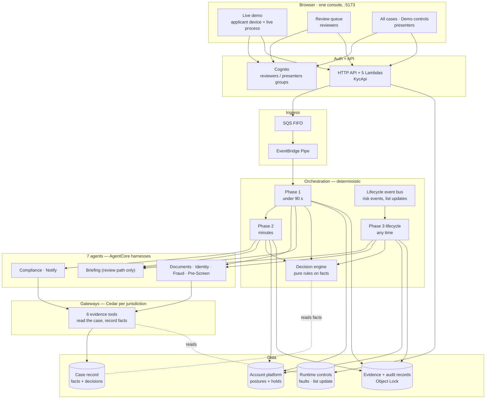

# KYC in 90 Seconds

Agentic KYC (Know Your Customer) onboarding built for AWS re:Invent 2026. An applicant proves who
they are in a browser (a live face check and an identity document). Agents on Amazon Bedrock
AgentCore gather the evidence through tools; **the tools record what they found as facts on the
case, and a deterministic rules engine decides on those facts alone**. The agents explain; they
never decide. A person handles whatever the rules cannot clear, and the account itself — not the
UI — enforces the limits the decision sets.

This document takes you from an empty machine to a working demo. The run-of-show for the talk is
in [`docs/RUNBOOK.md`](docs/RUNBOOK.md); every design decision and the measurement behind it is in
[`docs/DECISIONS.md`](docs/DECISIONS.md) and [`docs/MEASUREMENTS.md`](docs/MEASUREMENTS.md).

---

## 1. What this is, in plain English

- An **applicant**, in a bank's app, agrees to the face check, declares their details, photographs
  their identity document, records a selfie video (it streams straight to Amazon Rekognition
  Face Liveness), checks everything and submits.
- **Phase 1** (the 90-second budget): four agents run in parallel — Documents, Identity, Fraud,
  Pre-Screen. Each calls one evidence tool through an AgentCore Gateway, authorised by Cedar.
  The tool reads its inputs from the case record and **records its result there**. The rules
  then decide on the recorded facts: open a provisional account with limits, ask for one more
  thing (step-up), send to a person, or decline. An agent cannot steer what is checked: it
  passes only the applicant id, and what it says about a result is never read by the rules.
- The account opens **at the account platform with real restrictions** (no money out, a deposit
  ceiling), and the platform itself refuses what the restrictions forbid.
- **Phase 2** (minutes later): politically exposed persons and adverse media, a re-screen if the
  sanctions list changed in the meantime, then the full decision — lift the limits, keep some, or
  freeze. A Notify agent writes the customer message, and a deterministic tipping-off guard
  replaces any message that would tell them *why*, or that says something about the account its
  state rules out or quotes figures it cannot check (D-39).
- **Phase 3** (any time after): a risk event or a **sanctions list update** re-screens open
  accounts. A confirmed match freezes the account at once and a person confirms it; a raised risk
  restricts it under a hold until a person decides; nothing restores an account without a person.
- A **reviewer** sees a briefing written from the recorded facts, the facts themselves, each
  phase's decision and the agents' words labelled as narrative, and decides with a rationale.
  Approving a possible match clears that alert for good; a confirmed match cannot be approved.

Synthetic, and labelled so on screen: the sanctions, PEP and adverse-media lists, and the demo
identity documents. Everything else is the real AWS service: the agents and models, the tool
calls, Textract and the MRZ check digits, Rekognition liveness and face comparison, Step
Functions, the audit records under Object Lock.

---

## 2. Architecture



### 2.1 The stacks

Stage 1 is nine stacks; stage 2 is the Cedar policies, which must name Gateway ARNs that only
exist after stage 1 (Cedar forbids wildcard resources). `make deploy` runs both.

| Stack | What it creates |
|---|---|
| `KycFoundation` | KMS keys, evidence buckets (Object Lock **at creation**, irreversible; retention per `evidenceLock`), biometric bucket (24-hour lifecycle), case table, IAM roles |
| `KycTools` | The tools Lambda (six evidence tools), the account platform Lambda and table, the runtime-control parameters |
| `KycGateways` | Four AgentCore Gateways (US/UK/AU/JP) and their policy engines, attached LOG_ONLY until checked |
| `KycHarnesses` | Seven AgentCore harnesses and their pinned endpoints |
| `KycOrchestration` | Phase 1 and Phase 2 state machines, the decision engine, the audit writer, the review queue |
| `KycIngress` | SQS FIFO queue and the Pipe that starts Phase 1 |
| `KycLifecycle` | The lifecycle event bus, its archive, the Phase 3 state machine, the decision history table |
| `KycAuth` | Cognito user pool (`reviewers`, `presenters`), identity pool for the liveness detector |
| `KycApi` | HTTP API, JWT authorizer, and five Lambdas: liveness, intake, review, accounts, demo |
| Stage 2 (no stack) | Cedar policies, 9 per jurisdiction's engine (6 tool permits, a prompt-attack guardrail, 2 content filters), created by `policies/deploy_stage2.py` with boto3. CloudFormation's handler for this resource type failed the stage, so `KycPolicies` exists only for the tests and is never deployed. No PII suppression yet: no tool declares an output schema for it to scan (D-34) |

### 2.2 The agents and the tools

| Agent | Phase | Model (US) | Tool | Its fact |
|---|---|---|---|---|
| Documents | 1 | Nova Lite | `s3_get_document` | `documentExtraction` — Textract text and the MRZ, check-digit verified |
| Identity | 1 | Nova Lite | `rekognition_compare_faces` | `factFaceMatch` — match and a similarity band, never a raw score |
| Fraud | 1 | Nova Lite | `velocity_check` | `factVelocity` — `NOT_ESTABLISHED` in this build: no device or IP is captured at intake |
| Pre-Screen | 1, 2, 3 | Nova Lite | `sanctions_screen` | `factScreening` — exact and variant matching, every alert classified, every exclusion reasoned |
| Compliance | 2 | Nova 2 Lite (reasoning) | `pep_lookup`, `adverse_media` | `factPep`, `factAdverseMedia` |
| Notify | 2 | Nova Micro | — | The customer message, checked by the tipping-off guard |
| Briefing | review | Nova Lite | — | The reviewer briefing, written from the facts |

The rules (`decision-engine/`) read only the facts. Missing, stale, not-performed or
against-an-outdated-list facts all route to a person; none can approve. Outside the US the build
routes every case to a reviewer for the jurisdiction (`DECIDED_JURISDICTIONS`).

### 2.3 Applicant journey

The phone shows a bank's own app (AnyCompany Bank), in the order digital onboarding uses (D-37).
The presenter picks the demo persona beside it, from *New application*, so the app opens with the
details filled in and never shows a persona.

1. Welcome: where the applicant lives, which account, and consent to the face check, with the
   notice on what happens to the video.
2. About you: the declared identity.
3. ID document: photographed with the webcam on a full-window stage and cropped to the guide, or
   uploaded. It goes to the evidence bucket now, before the selfie.
4. Selfie video: the face check fills the window, centred under the webcam, and starts by itself
   once the camera is on.
5. Review, then Submit: nothing reaches the bank before this, and the four agents start now.
6. While Phase 1 decides, the phone says what is happening and nothing it cannot know: no
   counter. The console beside it shows the time, from the case record's own timestamps.
7. With an account: the balance, what is limited today (live from the account platform), and
   one-tap actions (Add money, Send abroad, Pay someone, Withdraw cash) that the platform allows
   or refuses. The page keeps polling, so Phase 2 lifting the limits, or a hold after a list
   update, appears by itself.
8. On a step-up: redo the selfie or take a new photo of the ID, review, and resubmit, in the
   same application.

### 2.4 Reviewer journey

1. Sign in (`reviewers` group). The queue shows each case's phase, why it is there and its age.
2. Open a case: the briefing, the screening alerts and what an approval would clear, then the
   recorded facts, each phase's decision, the agents' narrative, the execution timeline, the
   account as the platform holds it and every message the guard replaced, with why.
3. Decide with a rationale. The decision, the reviewer's name and any cleared alerts are written
   in one conditional write and sealed in the audit record.

### 2.5 Presenter controls

All cases and Demo controls (`presenters` group) show every case with its measured time to
decision, and drive the acts through the same runtime controls production code reads: faults (a
tool reported unavailable, an agent given less time), a sanctions list update (a batch of four
synthetic listings, one of which names a customer) that fans out one event per open account, and
reset. These routes exist only when deployed with
`-c demoControls=true` (the default here) — **a presenter can freeze any open account**, so
remove them with `-c demoControls=false` for anything but a demo.

### 2.6 The console

One web app, one sign-in, one port (`frontend/apps/console`, http://localhost:5173):

| View | Who | What it shows |
|---|---|---|
| Live demo | anyone signed in | The applicant's phone on the left, showing only the bank's app; *New application* opens it for a demo persona (or blank), and a note under the phone names that persona's ID. On the right, the case in two views of the same records. *Backstage* (reviewers; the default): each phase as a live timeline from its Step Functions execution history, one lane per service, the four agents side by side, each tool's fact where it landed, a feed of every write, and a link to the execution in the Step Functions console. *Story*: every stage as the case record records it, in plain words, with the time each landed. One tab per application, kept across a reload |
| Review queue | `reviewers` | The queue, the briefing and alerts, the decision form, the full trace |
| All cases | `presenters` | Every case, its state and time to decision; a row opens that case's process and record |
| Demo controls | `presenters` | The Act 3 list update, faults, the stopwatch, reset |

For a solo presenter, one account in both groups runs every view. The applicant and the reviewer
are then the same person in the audit record; use a separate reviewer account where that matters.

---

## 3. Prerequisites

- An AWS account with Bedrock Nova model access, AWS CLI credentials for it
- Node.js 20+ (CDK and the web apps) and Python 3.12 (backend and infra)
- **Read the cost and Object Lock warning in section 5 first.**

---

## 4. Run against an existing deployment

```bash
cd frontend && npm ci
cp apps/console/.env.local.example apps/console/.env.local    # fill in from the stack outputs
npm run dev                                                   # http://localhost:5173
```

Group membership is granted by hand, never by sign-up:
`scripts/prepare_demo.py users --user-pool-id ... --presenter you@example.com --reviewer you@example.com --apply`.
Sign out and in again after a group change, so the new group is in the token.

---

## 5. Deploy your own copy

**Cost and risk:** real, billable resources — AgentCore harnesses and model inference, Step
Functions, Lambda, DynamoDB, S3, Textract, Rekognition. The evidence buckets always have Object
Lock enabled; what it holds depends on the deployment (D-35). **A demo deployment (the default)
locks evidence and decision records in GOVERNANCE mode for one day**, because its documents carry
the presenter's real face: a delete is refused, an administrator can bypass that, and after a day
anyone can delete. **`DEMO_CONTROLS=false` (or `EVIDENCE_LOCK=COMPLIANCE`) locks in COMPLIANCE
mode for seven years: nobody, root included, can delete what is written.** `make destroy`
removes the rest, except what is retained by policy: the evidence buckets and the case table
(deletion protection on).

```bash
aws configure
npx cdk bootstrap aws://<ACCOUNT_ID>/us-east-1        # once per account and Region
make install                                         # venv + pinned Python dependencies
make test                                            # the whole suite, before anything exists
make evals                                           # offline: every persona's outcome
make deploy                                          # stage 1 (nine stacks), then Cedar
make demo-assets                                     # synthetic documents (add presenter photos first)
make frontend                                        # npm ci + build the console
make preflight                                       # read-only: is the account ready?
```

Context flags (`cdk deploy -c ...`, or `ENFORCEMENT=...` / `DEMO_CONTROLS=...` for `make deploy`):

| Flag | Default | Meaning |
|---|---|---|
| `policyEnforcement` | `LOG_ONLY` | Cedar evaluates and logs; switch to `ENFORCE` only after `make check-policies` exits 0. Use `make deploy ENFORCEMENT=ENFORCE`: a bare `cdk deploy -c` moves the Gateways but not the policies |
| `demoControls` | `true` | The `/demo/*` routes behind the console's All cases and Demo controls |
| `evidenceLock` | `DEMO` with demo controls, else `COMPLIANCE` | `DEMO`: GOVERNANCE for one day. `COMPLIANCE`: seven years, irreversible per object. Applies to what is written after the change |
| `livenessChallenge` | `FaceMovementChallenge` with demo controls, else `FaceMovementAndLightChallenge` | The Face Liveness challenge (D-36). Movement only: no flashing colours, a few seconds quicker. Movement and light: AWS's recommended default for the highest accuracy. `make deploy LIVENESS_CHALLENGE=...` |
| `provisionedConcurrency` | `0` | Provisioned concurrency on the tools Lambda's `live` alias; measure first (`make measure`) |

Change one thing and redeploy only its stack: `npx cdk diff <Stack>` then `npx cdk deploy <Stack>`
from `infra/` (for example, `infra/kyc/asl.py` is `KycOrchestration` and `KycLifecycle`).

---

## 6. Environment files

| File | Variables |
|---|---|
| `frontend/apps/console/.env.local` | `VITE_USER_POOL_ID`, `VITE_USER_POOL_CLIENT_ID`, `VITE_IDENTITY_POOL_ID`, `VITE_API_BASE_URL` (the `KycApi` `ApiUrl`, no trailing slash) |

They are public client identifiers rather than secrets, but they point at one account: share
them with people you trust to use it, and never commit a filled-in `.env.local`.

---

## 7. Checking it works

| Command | Needs AWS | What it shows |
|---|---|---|
| `make test` | no | the whole suite, including the synthesised templates and the state machine graphs |
| `make evals` | no | each persona's outcome through the real tools and rules, 1,000 identical replays, narrative-proofing, fail-closed checks |
| `make preflight` | read-only | stacks, demo controls, console groups, where each persona stands |
| `make measure` | read-only | p50/p95 time to decision and model usage from real cases |
| `make export` | read-only | the last day's executions, state by state |
| `make check-policies` | read-only | whether Cedar can move to ENFORCE |
| `scripts/loadtest.py` | **writes** | many real Phase 1 runs from one rehearsal; dry run unless `--apply` |

---

## 8. Repository layout

```
├── infra/            CDK app (app.py), stacks (kyc/), state machines as data (kyc/asl.py)
├── tools/            the six evidence tools; facts recorded on the case (kyctools/)
├── decision-engine/  the rules: pure functions over recorded facts
├── review/           the review handler: first writer wins, dispositions, task tokens
├── api/              HTTP handlers: liveness, intake, review, accounts, demo; the tipping-off guard
├── account-stub/     the account platform: postures, holds, transactions refused by restriction
├── audit/            the decision record, sealed under Object Lock
├── harnesses/        agent prompts
├── policies/         Cedar policy generation (stage 2)
├── frontend/         the console (apps/console) and the shared API client and components
├── demo-assets/      synthetic documents and personas
├── evals/            offline evals: real tools and rules, fake AWS services
├── scripts/          measure, export, Cedar check, demo preparation, load test
├── docs/             RUNBOOK, DECISIONS, MEASUREMENTS
└── spike/            exploration scripts, not production code
```
